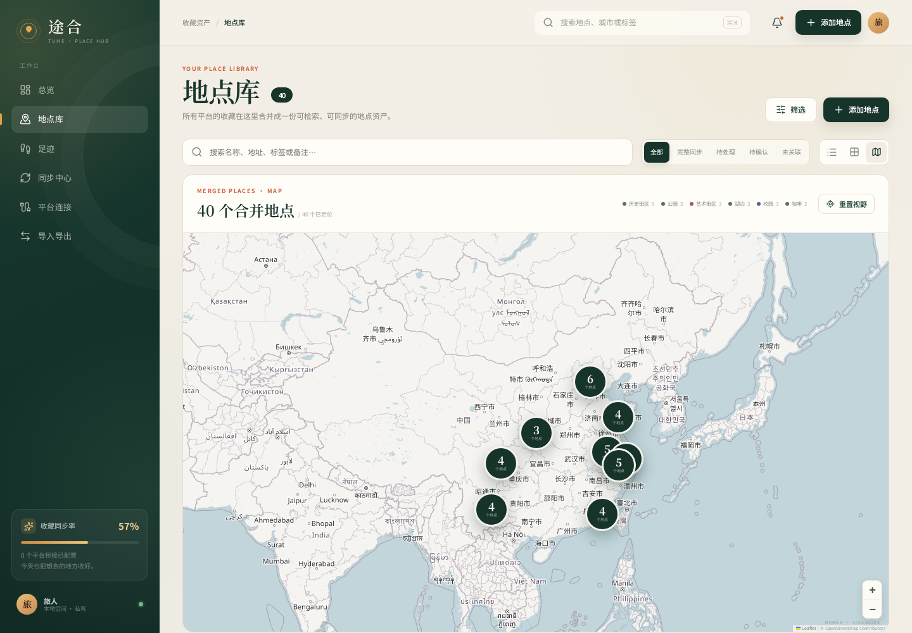
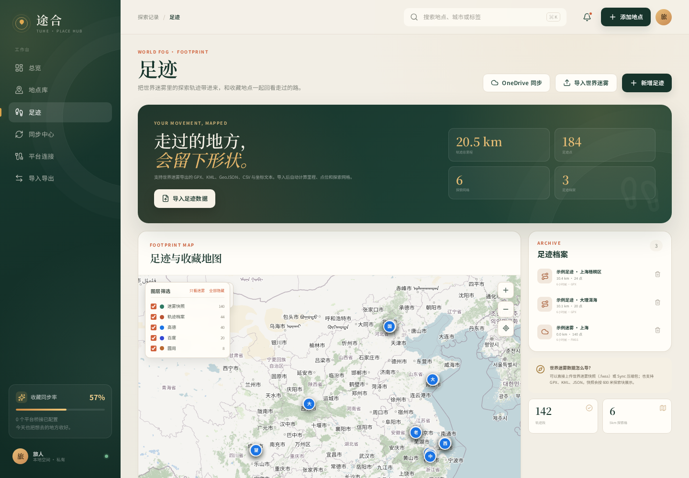
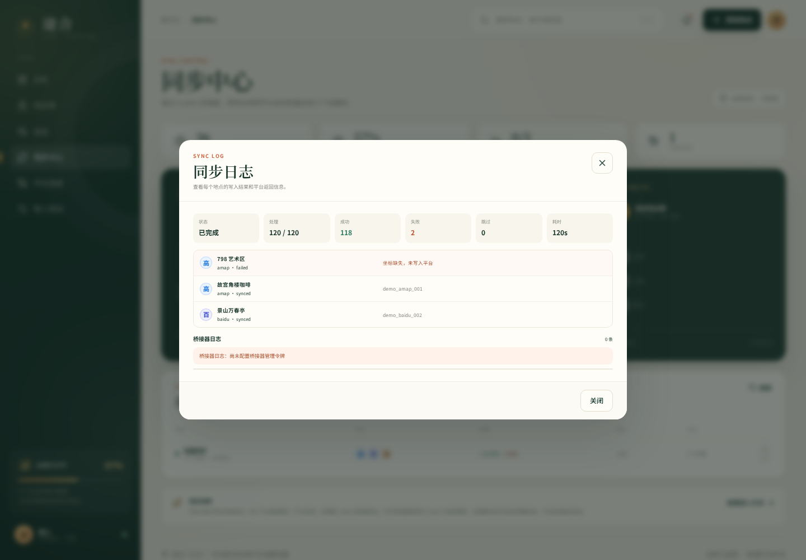

# 途合 TUHE · Demo

把 **高德地图、百度地图、圆周旅迹** 的收藏地点收进同一个地点库，做检索、去重、地图可视化、城市分析和跨平台同步；同时支持导入 **世界迷雾** 快照与 GPX/KML 足迹。

这是一个**可直接运行的演示版**：内置 40 个虚构地点、3 份示例足迹和 1 份示例迷雾快照，不包含任何真实账号、Cookie 或私人数据。









## 功能

- **统一地点库**：名称、地址、城市、分类、标签、评分、备注、坐标
- **合并地图**：聚类展示所有平台收藏，支持按平台/图层筛选
- **城市分析**：按城市统计收藏、平台构成和地点偏好
- **跨平台去重**：同名且距离接近的地点自动合并
- **多格式导入**：CSV / JSON / KML / GPX / TXT
- **平台化导出**：按高德 GCJ-02、百度 BD-09、圆周 GCJ-02 导出
- **世界迷雾**：支持 `.fwss` 快照、Sync zip，以及 GPX/KML/GeoJSON
- **同步中心**：任务进度、逐条结果、桥接器日志
- **Cookie 桥接器**：可选的本地桥接服务，真实请求由你自己配置
- **本地优先**：数据保存为本地 JSON，无云端账号体系

## 快速开始

需要 Node.js 24+。

```bash
npm install --include=dev
npm run dev
```

- 前端：<http://localhost:5173>
- API：<http://localhost:8787>

生产模式：

```bash
npm run build
npm start
```

打开 <http://localhost:8787>。

### Docker

```bash
docker compose up -d --build
```

打开 <http://localhost:8787>。

### 演示模式

默认即演示模式，首次启动会自动写入虚构数据。要关闭演示数据并从空库开始：

```bash
TUHE_DEMO=0 npm start
```

## 环境变量

| 变量 | 默认值 | 说明 |
| --- | --- | --- |
| `TUHE_PORT` | `8787` | 服务端口 |
| `TUHE_DATA_DIR` | `./data` | 数据目录 |
| `TUHE_DEMO` | `1` | `1` 使用内置演示数据，`0` 使用空库 |
| `TUHE_BRIDGE_URL` | 空 | 可选：Cookie 桥接器 Webhook |
| `TUHE_BRIDGE_TOKEN` | 空 | 可选：桥接器 Webhook Token |
| `ONEDRIVE_CLIENT_ID` | 空 | 可选：OneDrive OAuth 应用 ID |
| `ONEDRIVE_CLIENT_SECRET` | 空 | 可选：OneDrive OAuth 应用密钥 |

## 目录结构

```text
src/                 React 前端
server/              Express API、数据存储、解析与同步
bridge/              可选的 Cookie 桥接器
samples/             示例导入文件
docs/screenshots/    README 截图
```

## 关于真实平台同步

高德、百度、圆周旅迹都没有开放个人收藏的公开写入 API。项目中的桥接器用于**你自己抓取并配置**的网页请求，不包含任何平台凭证。

演示版默认**不连接任何平台**，平台连接页会显示“未配置桥接”。接入方式：

1. 启动 `bridge/`：`cd bridge && docker compose up -d --build`
2. 打开 <http://localhost:8790>
3. 按页面向导粘贴一次平台 Cookie 与请求模板
4. 在途合的「平台连接」里填入桥接地址和 Token

> 平台接口可能随版本变化。请仅同步你本人有权访问的数据，并遵守各平台服务条款。

## 数据与隐私

- 演示数据全部为虚构内容
- 不包含真实 Cookie、Token、账号或私人地点
- 运行时数据默认写入 `data/db.json`
- `data/`、`node_modules/`、`dist/` 已在 `.gitignore` 中排除

## 常用命令

```bash
npm run dev        # 同时启动前端和 API
npm run build      # 类型检查 + 构建前端
npm start          # 生产模式启动
npm test           # 运行服务端测试
npm run demo       # 仅启动 API（演示模式）
```

## License

MIT
